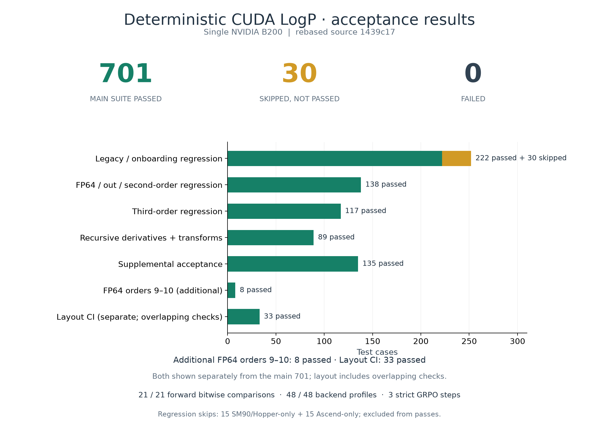
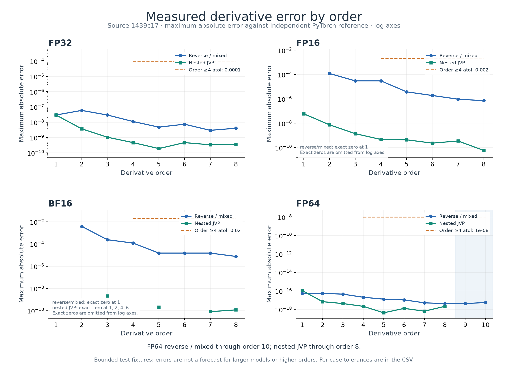
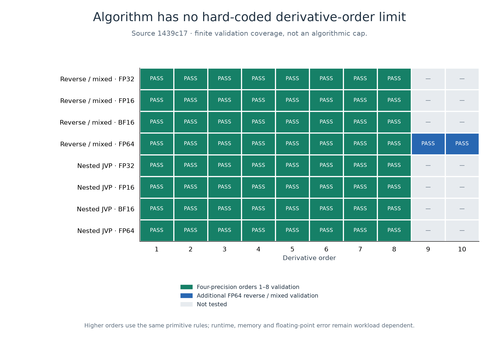

# Deterministic CUDA LogP validation figures

Source implementation: `1439c17a3f4cf321ba25486e261e795dad3c4a31`.
Rebased onto upstream main: `16b81175874ecf11d5ff05c00de3b69e9457591b`.
Fresh native extension SHA-256: `9f87d7a020445934907617eb61c9009e07434c0e5a33b67fd4cdca8edbc3ff8e`.
Hardware: one NVIDIA B200. These assets visualize recorded acceptance results; generating them does not rerun the CUDA tests.

## Acceptance results



The main suite contains 701 passes, 0 failures and 30 skips. The skipped cases are 15 SM90/Hopper-only tests and 15 Ascend-only tests, neither applicable to B200. Eight additional FP64 order 9–10 cases passed and are displayed separately from the main suite. Current-main layout CI passed 33 checks, shown separately because it overlaps main-suite coverage. The report also records 21 bitwise forward comparisons, 48 backend profiles and three strict deterministic GRPO steps.

## Numerical results



Each point is the maximum absolute error within a precision, derivative order and method, aggregated from the recorded recursive acceptance cases. Reverse/mixed derivatives and nested JVPs are separate lines. Comparisons use independent PyTorch references. All plotted cases passed their individual assertions. Dashed lines show the common absolute tolerances for orders 4 and above; order 1–3 case-specific tolerances are in [derivative-errors.csv](derivative-errors.csv). Relative tolerance is zero. Exact-zero measurements are noted and omitted from logarithmic axes, rather than assigned fabricated positive values. A line break caused by an exact zero is not an untested order.

Inputs and direction vectors are bounded test fixtures. Error trends in this figure do not establish trends for larger workloads or untested derivative orders. These figures contain no latency or memory benchmarks.

## Algorithm and tested range



The algorithm has no hard-coded derivative-order limit: derivative rules recurse through the same differentiable primitives. Higher orders do not require new order-specific backward kernels. Compute/memory requirements and floating-point error depend on the workload, so this architectural property is distinct from validation at every possible order.

FP32, FP16, BF16 and explicit FP64 reverse-mode directional/mixed derivatives and nested JVPs were tested at orders 1–8. FP64 reverse-mode directional/mixed derivatives were additionally tested at orders 9–10. Forward-mode coverage stops at order 8. Gray cells mean **not tested**, not failed or unsupported. Orders beyond the matrix are also untested. The scope is single-GPU acceptance, including dense/indexed/out and transform combinations; it is not a multi-GPU or production-model training guarantee.

## Provenance and reproduction

- [Full recorded report](validation-report.json): individual results, skip reasons, extension/source provenance, profiler evidence and numerical errors.
- [Compact figure data](figure-data.json) and [per-case error CSV](derivative-errors.csv).
- [SHA-256 manifest](manifest.json): hashes of the files used for this visualization.
- [Migration audit](migration-audit.json): preserved deterministic source behavior, current-main generic/SM90 code, canonical/legacy import identity and all six DCO signoffs.
- Logs, JUnit XML and runner scripts retain the fresh acceptance evidence.
- PNG files support direct GitHub PR embedding; matching SVG files provide vector exports.

Regenerate the figures from the uploaded report:

```bash
python -m pip install matplotlib==3.11.2 numpy==2.4.6
python generate_figures.py
```

To rerun the underlying GPU acceptance, use `runs/b200-autograd/rebased-main-validation/run-validation.sh` from the validation workspace. The new report includes absolute rerun commands and input artifact hashes. The runner checks that the original `0658d71` evidence is preserved unchanged. The live CUDA environment and old binary baseline remain in that workspace; this asset branch alone does not contain the complete GPU test workspace. Historical assets under `deterministic-logp/0658d71` are unchanged and do not establish acceptance of the rebased source.

PR-ready embeds:

```markdown


```
