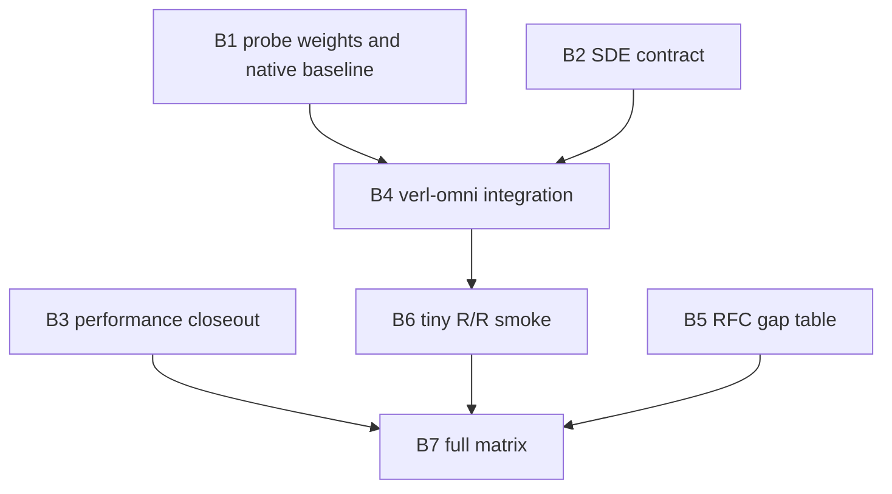

# H3 x VeRL-Omni end-to-end control experiment

This directory is the **single coordination hub** for the MiniMax-H3 train/rollout consistency and
performance program aligned with [RFC #420](https://github.com/RL-Align/RL-Kernel/issues/420) and the
methodology of [PR #377](https://github.com/RL-Align/RL-Kernel/pull/377) (VIME Qwen3-8B P/P vs R/R).

Branch `plan/h3-verl-omni-e2e` holds **documentation only** (no kernel code). Progress lives in
[`TASKS.md`](TASKS.md). Do not open a PR from this branch unless explicitly requested.

## Product goal (v0.1.0 analogy)

| Arm | Orchestrator | Training path | Rollout path | Role |
| --- | --- | --- | --- | --- |
| **P/P** | VeRL-Omni (fork `main`) | Diffusers `MiniMaxH3Transformer3DModel` + FSDP2 + Ulysses SP | vLLM-Omni H3, native fused kernels | Production baseline; train/rollout **need not** match bitwise |
| **R/R** | VeRL-Omni (fork branch `rl-kernel/h3`) | Same stack, RL-Kernel strict operators | Same stack, RL-Kernel strict via adapter | Target arm: **zero drift** + end-to-end time **not worse** than P/P |

If P/P shows non-zero log-prob or latent drift while R/R is bitwise zero and competitive on wall
clock, that is the community value proposition (same story as VIME + RL-Kernel).

## Pass criteria

1. **Consistency (R/R):** every training step: `mismatch_count == 0` and `max_abs_diff == 0` for the
   agreed comparator (SDE transition log-prob once `stochastic_transition_contract` is approved; plus
   `prev_sample_mean` and velocity until then).
2. **Baseline (P/P):** same metrics **non-zero** on the same workload (proves the baseline is not
   already consistent).
3. **Performance:** paired bootstrap over aligned steps; **end-to-step** time for R/R not slower than
   P/P (per-stage breakdown reported like #377).
4. **Integrity:** no imputation, no dropped failed steps; per-step sealed artifacts and readback.

## Documents

| File | Purpose |
| --- | --- |
| [`TASKS.md`](TASKS.md) | Blockers B1–B7, dependencies, status, evidence links |
| [`rfc-gap.md`](rfc-gap.md) | RFC #420 rows, §6.3–6.4 arms, H-C0–H-C7, final gates |
| [`experiment-design.md`](experiment-design.md) | Matched workload, metrics, matrix, artifacts |
| [`stochastic-transition-contract-draft.md`](stochastic-transition-contract-draft.md) | B2 SDE/CPS draft for maintainer review |
| [`verl-omni-integration-outline.md`](verl-omni-integration-outline.md) | B4 hook points and file map |
| [`log.md`](log.md) | Dated decisions and results |

## Dependency graph

## External dependencies

- Open RL-Kernel PR stack [#567](https://github.com/RL-Align/RL-Kernel/pull/567)–[#576](https://github.com/RL-Align/RL-Kernel/pull/576) merged into `test-h3`.
- Community fork of `verl-omni` (baseline on `main`, integration on `rl-kernel/h3`).
- H100 multi-GPU allocation (8 GPUs across two nodes for realistic FSDP + rollout TP=2).
- Maintainer sign-off on the SDE transition contract before claiming transition log-prob fields.
