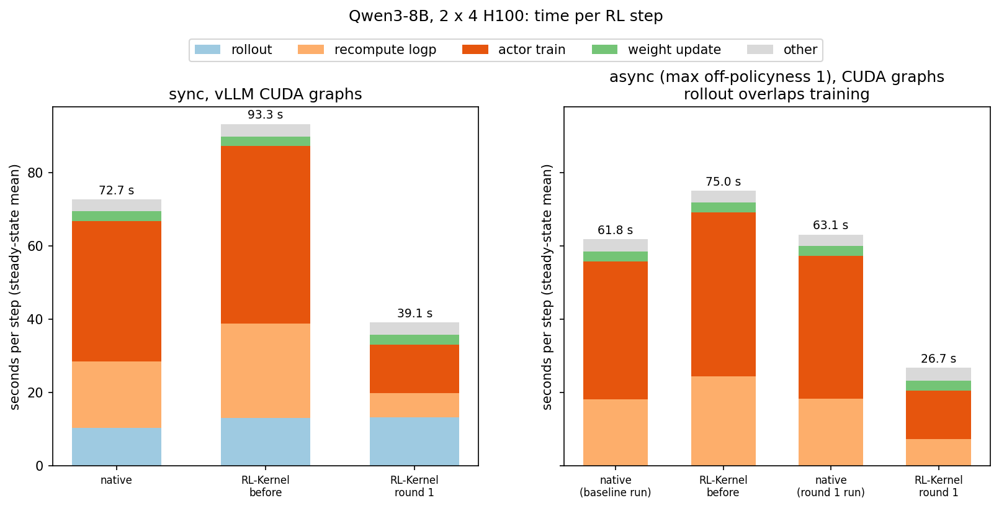
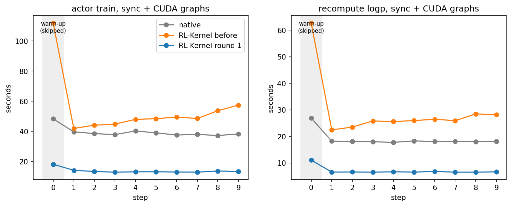
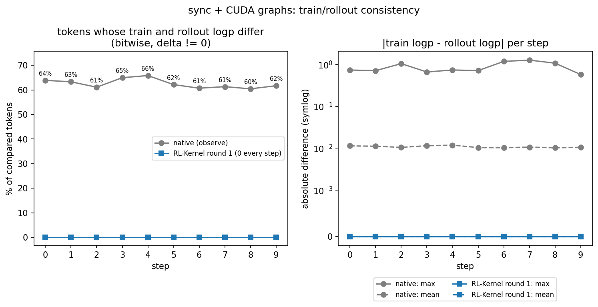
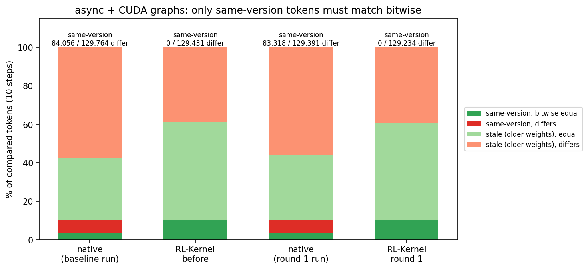
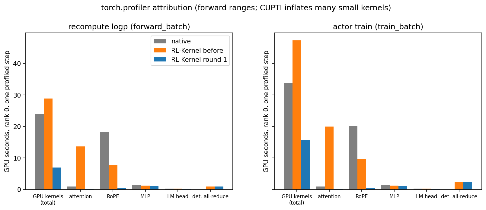
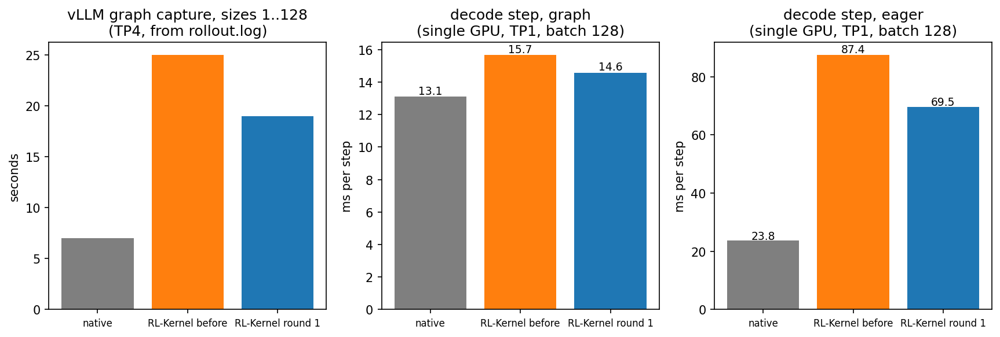

# AReaL x RL-Kernel: CUDA graph validation and training-side round 1

Train/rollout consistency and performance of the AReaL integration
([docs](../../../docs/integrations/orchestrators/areal/README.md)) on Qwen3-8B /
GSM8K, followed by a first optimization round of the RL-Kernel arm's
training-side cost. Machine-readable numbers are in [`results.json`](results.json);
the run artefacts behind every table are listed under [Raw data](#raw-data).

## Summary

> **Speedups vs native are under re-measurement.** In every run below, the native
> actor shared a node with the driver, the AReaL controller and the Ray head, which
> inflated its train time about 4.7x, and the native arm ran without RoPE fusion.
> With both fixed, native trains faster than RL-Kernel round 1. See
> [Placement and native fused RoPE](#placement-and-native-fused-rope-re-measurement-pending).
> The consistency results are not affected.

- The RL-Kernel arm stays bitwise consistent in every run: PASS in every
  configuration, with 0 mismatching tokens and max abs diff 0 in sync mode.
- Round 1 cuts the RL-Kernel arm's actor train time from 48.48 to 13.24 s/step
  (0.27x) and recompute logp from 25.82 to 6.59 s/step (0.26x). End-to-end step
  time drops from 93.26 to 39.05 s (0.42x). The training side is now faster than
  the native arm: train is 0.34x and recompute 0.36x of native, and the
  end-to-end step is 0.54x of native.
- vLLM graph capture for batch sizes 1..128 drops from 25 s to 19 s (native: 7 s).
  The remaining gap is per-forward host overhead, analysed below.
- Rollout time is unchanged within run-to-run noise (12.91 vs 13.24 s, paired
  95% CI [1.00x, 1.06x]). The RL-Kernel rollout is still 1.29x of native.
- In async mode (max off-policyness 1), round 1 cuts the RL-Kernel step from
  75.04 to 26.68 s (0.36x). That is 0.42x of the native arm run in the same
  session (63.08 s). The RL-Kernel arm stays PASS with 0 of 129,234
  same-version tokens mismatching.
- With the same consistency metrics turned on for native sync training
  (`--native-observe`), 62.5% of the compared tokens (791,080 of 1,264,941)
  have a train logp that differs from the rollout logp. The RL-Kernel arm has 0.
  The metrics do not change native timing (step 72.55 vs 72.67 s, paired 95% CI
  [0.99x, 1.01x]).
- [Figures](#figures) summarise these results.

## Setup

| item | value |
| --- | --- |
| model / data | Qwen3-8B, BF16; GSM8K |
| hardware | 2 nodes x 4 H100 (SM90); Megatron TP4 actor on one node, vLLM TP4 rollout on the other |
| software | AReaL 2.1.1 (unmodified), vLLM 0.19.1, megatron-core 0.19.0, Transformer Engine 2.11.0, flash-attn-4 4.0.0b14 |
| launch | `verify run --nodes 2 --gpus 4 --scheduler ray --vllm-execution graph` |
| vLLM graphs | `--optimization-level 0`, `cudagraph_mode=FULL_DECODE_ONLY`, capture sizes 1..128 |
| timing | `timeperf/*` steady-state means over 10 steps, first step skipped; paired bootstrap 95% CI |

The hardware has no eight-GPU node, so weight sync and NCCL traffic cross the
inter-node network. Absolute `update_weights`, startup and end-to-end times are
therefore not comparable with a single eight-GPU node. Native vs RL-Kernel
comparisons on the same topology remain valid.

Environment notes for reproducing:

- Megatron needs Transformer Engine, which was built from source against
  CUDA 12.9.
- vLLM's bundled FA4 CuTe lacks `return_lse`, so the `flash-attn-4` wheel was
  installed instead.
- vLLM's `ApplyRotaryEmb` imports `flash_attn.ops.triton.rotary`, so that module
  was copied unchanged from flash-attention v2.8.3 for the native arm.
- On multi-node runs:
  - set `AREAL_ALLOW_DEFAULT_ADMIN_KEY=1` and `RLK_AREAL_WORKERS_READY_TIMEOUT=300`;
  - unset `SLURM_*` before starting Ray and the trainer, because `SLURM_PROCID`
    overrides AReaL's worker index.

## Baseline: CUDA graph validation (before round 1)

Consistency (RL-Kernel arm):

| stage | config | verdict | compared tokens | mismatching | max abs diff |
| --- | --- | --- | ---: | ---: | ---: |
| S2 | smoke, graph | PASS | 8,192 | 0 | 0 |
| S3 | sync, graph | PASS | 1,255,011 | 0 | 0 |
| S4 | async, graph | PASS | 129,431 same-version | 0 same-version | - |
| S5 | sync, eager | PASS | 1,264,929 | 0 | 0 |

- In S4, the RL-Kernel arm has 494,321 mismatching tokens in total. All of them
  are stale samples, generated under an older weight version.
- The native arm is REPORT_ONLY:
  - in sync mode, max abs diff is 2.0-3.0;
  - in async mode, it has 84,056 same-version mismatches out of 129,764
    same-version tokens.

Performance (s/step):

| arm | rollout | recompute logp | train | end-to-end | graph capture |
| --- | ---: | ---: | ---: | ---: | ---: |
| native, graph (S3) | 10.28 | 18.08 | 38.47 | 72.67 | 7 s |
| RL-Kernel, graph (S3) | 12.91 | 25.82 | 48.48 | 93.26 | 25 s |
| native, eager (S5) | 26.91 | 18.01 | 37.58 | 88.22 | - |
| RL-Kernel, eager (S5) | 95.25 | 25.63 | 47.64 | 174.84 | - |
| native, async graph (S4) | - | 18.01 | 37.73 | 61.82 | 8 s |
| RL-Kernel, async graph (S4) | - | 24.36 | 44.81 | 75.04 | 25 s |

CUDA graphs made the RL-Kernel rollout 7.4x faster than eager. The RL-Kernel
arm was still 28% slower end to end than native with graphs on both arms. The
largest gaps were recompute logp (+43%), train (+26%) and graph capture
(25 s vs 7 s), which are the targets of round 1.

## Round 1: where the time went

`verify run --profile-steps 3` profiled actor version 3 on rank 0 in both arms.
The table shows the GPU span of each `rlk::*` range. These ranges cover forward
entry points only; backward kernels run in the autograd engine, outside them.
CUPTI inflates paths that launch many small kernels.

Recompute logp (`forward_batch`):

| bucket | native | RL-Kernel before | RL-Kernel round 1 |
| --- | ---: | ---: | ---: |
| GPU kernel time, sum (s) | 24.01 | 28.88 | 6.95 |
| `rlk::attention` (324 calls) | 0.92 | 13.64 | 0.05 |
| `rlk::rope` (648 calls) | 18.17 | 7.84 | 0.50 |
| `rlk::mlp` (324 calls) | 1.29 | 1.17 | 1.11 |
| `rlk::lm_head` (9 calls) | 0.28 | 0.25 | 0.20 |
| `rlk::det_collective.all_reduce` (648 calls) | - | 0.94 | 0.91 |

Actor train (`train_batch`):

| bucket | native | RL-Kernel before | RL-Kernel round 1 |
| --- | ---: | ---: | ---: |
| GPU kernel time, sum (s) | 33.83 | 47.36 | 15.65 |
| `rlk::attention` (324 calls) | 0.94 | 19.92 | 0.05 |
| `rlk::rope` (648 calls) | 20.12 | 9.68 | 0.53 |
| `rlk::mlp` (324 calls) | 1.40 | 1.18 | 1.16 |
| `rlk::det_collective.all_reduce` (1629 calls) | - | 2.29 | 2.23 |

Before round 1, attention and RoPE took about 75% of the RL-Kernel arm's
recompute GPU time:

- Attention launched FA4 once per group of equal-length packed sequences, with
  copies and host syncs in between.
- RoPE built positions on the CPU, sequence by sequence, with `.item()` syncs.

The remaining RL-Kernel cost is the deterministic TP all-reduce, the
deterministic GEMM and the FFN, all of which are part of the consistency
contract. The native RoPE range (18-20 s) suggests that Megatron runs RoPE
per sequence and unfused on THD inputs. Because of CUPTI inflation, treat this
as directional only.

## Round 1: changes

Each change keeps the numerical path identical. GPU tests in
`tests/integrations/orchestrators/areal/test_areal_strict_fastpaths_gpu.py`
compare the new and old paths bit for bit on SM90.

1. **Packed attention in one FA4 varlen launch** (CP=1, CUDA).
   - All packed sequences go to `flash_attn_varlen_func` with `cu_seqlens`,
     `deterministic=True`, `num_splits=1` and `pack_gqa`.
   - Output, LSE and dq/dk/dv are bitwise equal to the per-length batched
     launches, also for strided Q/K/V views of a fused QKV buffer and lengths
     up to 2,900. Forward plus backward of one layer with 25 packed sequences
     takes 0.72 ms instead of 13.6 ms.
   - `cu_seqlens` is cached per packing. Training precompile also builds the
     varlen kernels.
   - Other configurations keep the grouped path.
2. **RoPE positions on the GPU.**
   - Positions are built once per `cu_seqlens` and cached.
   - The bounds check is `torch._assert_async`, so there is no host sync.
   - The positions are the same integers as before, and the kernel and tables
     are unchanged.
3. **Shared RoPE tables and a token-major fast path.**
   - `inv_freq` and cos/sin are computed once per (theta, dim), shared across
     layers, and never rebuilt during graph capture.
   - vLLM's token-major `[T, H, D]` input calls `rope_apply_sm90` as
     `[T*H, D]` with a per-head repeat-interleaved table. The kernel works per
     row, so each row reads the same cos/sin as on the head-major path. This is
     bitwise equal at 1, 7, 128 and 2,048 tokens.
4. **Temperature 1.0 skips the fp32 logits scale** in logp forward and backward.
   Multiplying by 1.0 is the identity.
5. **Execute evidence memo.** Provenance with an identical signature is computed
   once. This change does not touch numerics.
6. **Deterministic GEMM without grad** calls `det_gemm_linear` directly, which is
   the same `torch.mm`, instead of going through the autograd Function. The route
   report is emitted once.
7. **Persistent FA4 CuTe JIT cache** on the RL-Kernel arm. It loads the same
   compiled kernels and saves about 5 s of vLLM init.
8. **Opt-in profiler** (`--profile-steps`, `RLK_AREAL_PROFILE_STEPS`).

## Round 1: results (S3, sync, graph, 10 steps)

| metric | native | RL-Kernel before | RL-Kernel round 1 | round 1 / before | round 1 / native |
| --- | ---: | ---: | ---: | ---: | ---: |
| actor train (s/step) | 38.47 | 48.48 | 13.24 | 0.27x [0.26, 0.29] | 0.34x [0.34, 0.35] |
| recompute logp (s/step) | 18.08 | 25.82 | 6.59 | 0.26x [0.24, 0.27] | 0.36x [0.36, 0.37] |
| end-to-end step (s) | 72.67 | 93.26 | 39.05 | 0.42x [0.40, 0.44] | 0.54x [0.53, 0.55] |
| rollout (s/step) | 10.28 | 12.91 | 13.24 | 1.03x [1.00, 1.06] | 1.29x [1.22, 1.34] |
| rollout tokens/GPU/s | 3,102.5 | 2,423.5 | 2,383.2 | 0.98x | 0.77x |
| weight update (s/step) | 2.68 | 2.62 | 2.60 | 0.99x | 0.97x |
| startup (s) | 728 | 849 | 662 | | |
| graph capture | 7 s | 25 s | 19 s | | |

- Consistency for round 1: PASS, with 1,264,805 tokens compared, 0 mismatching
  and max abs diff 0. Both profiled runs (4 steps each) also PASS with 0
  mismatches.
- The native and RL-Kernel-before columns come from the baseline run. Profiled
  steps include profiler post-processing and are not used for timing.
- vLLM's logged "generation throughput" is a coarse periodic sample and is not
  used. Rollout tokens/GPU/s is the reliable rollout metric.

## Round 1: results (S4, async, graph, 10 steps)

`verify run --mode async --arms native,rlkernel --max-offpolicyness 1`, with both
arms in one session. Rollout overlaps training in async mode, so the step time is
bound by training, and AReaL reports no separate rollout time.

| metric | native (same session) | RL-Kernel before | RL-Kernel round 1 | round 1 / before | round 1 / native |
| --- | ---: | ---: | ---: | ---: | ---: |
| actor train (s/step) | 39.02 | 44.81 | 13.28 | 0.30x [0.28, 0.31] | 0.34x [0.34, 0.35] |
| recompute logp (s/step) | 18.27 | 24.36 | 7.16 | 0.29x [0.28, 0.31] | 0.39x [0.37, 0.42] |
| end-to-end step (s) | 63.08 | 75.04 | 26.68 | 0.36x [0.35, 0.37] | 0.42x [0.42, 0.43] |
| weight update (s/step) | 2.64 | 2.64 | 2.76 | 1.04x [1.03, 1.06] | 1.04x [1.03, 1.06] |
| startup (s) | 755 | 901 | 810 | | |
| graph capture | 7 s | 25 s | 20 s | | |

- RL-Kernel before is the baseline run's S4 arm. The baseline run's native arm
  took 61.82 s/step, within 2% of this session's 63.08 s.
- Consistency, round 1: PASS. All 129,234 same-version tokens match bitwise.
  The 499,596 mismatching tokens (of 1,269,976 compared) are all stale, generated
  under the previous weight version, and max abs diff over them is 1.74.
- The native arm in the same session has 83,318 same-version mismatches out of
  129,391 (REPORT_ONLY), which matches the baseline run's 84,056 of 129,764.

## Native sync with consistency metrics

`verify run --mode sync --arms native --native-observe` turns on the same
consistency metrics (observe mode) for the native sync arm. Async native arms
always observe. Observe mode records the metrics only; numerics and the
training path are unchanged.

| step | 0 | 1 | 2 | 3 | 4 | 5 | 6 | 7 | 8 | 9 |
| --- | ---: | ---: | ---: | ---: | ---: | ---: | ---: | ---: | ---: | ---: |
| native tokens with train logp != rollout logp (%) | 63.9 | 63.3 | 61.1 | 65.0 | 65.8 | 62.1 | 60.7 | 61.3 | 60.4 | 61.7 |
| RL-Kernel round 1 (%) | 0 | 0 | 0 | 0 | 0 | 0 | 0 | 0 | 0 | 0 |

- Native in total: 791,080 of 1,264,941 tokens differ (62.5%); mean abs diff is
  about 0.01 per step and the max is 1.27. RL-Kernel round 1 (S3 above): 0 of
  1,264,805, max abs diff 0.
- Overhead of the metrics, compared with the baseline run's native arm:

| metric | native | native, observe | ratio [paired 95% CI] |
| --- | ---: | ---: | ---: |
| rollout (s/step) | 10.28 | 10.18 | 0.99x [0.96, 1.02] |
| recompute logp (s/step) | 18.08 | 18.07 | 1.00x [0.99, 1.01] |
| actor train (s/step) | 38.47 | 38.56 | 1.00x [0.99, 1.02] |
| end-to-end step (s) | 72.67 | 72.55 | 1.00x [0.99, 1.01] |

## Figures

Generated by [`make_figures.py`](make_figures.py) from the files under
[`runs/`](runs) (`python make_figures.py`, needs matplotlib).

Time per RL step, broken down by phase:

Actor train and recompute logp per step in sync mode. Step 0 includes warm-up
and is excluded from the means:

Train/rollout consistency in sync mode, per step:

Async consistency. Only tokens generated under the current weight version must
match bitwise:

Profiler attribution of the training-side GPU time (one profiled step, rank 0):

vLLM graph capture and single-GPU decode step:

## vLLM graph capture: 25 s vs 7 s

Single-GPU probe: Qwen3-8B, TP1, batch 128, 128 prompt and 128 generated tokens.

| arm | graph capture | graph decode (ms/step) | eager decode (ms/step) | prefill (s) |
| --- | ---: | ---: | ---: | ---: |
| native | 6 s | 13.11 | 23.79 | 0.402 |
| RL-Kernel before | 22 s | 15.66 | 87.39 | 0.544 |
| RL-Kernel round 1 | 17 s | 14.58 | 69.53 | 0.538 |

Capture runs full forwards for every batch size, so its time is roughly the
number of forwards times the per-forward host cost; GPU time is a small part of
it. The large gap between eager and graph decode shows the same host cost.

Round 1 removed part of it: per-layer provenance work, table construction
during capture, the head-major transposes in RoPE, and the autograd wrapper
around no-grad GEMMs. The 6.5 s FA4 decode-kernel compile happens during vLLM's
profile run, not during capture, and the persistent cache removes it from
later runs.

A cProfile of vLLM init attributes what remains, about 12 s in the multi-node
run:

- **cuBLASLt heuristics.** PyTorch queries heuristics on every deterministic
  GEMM call, which costs about 77 µs of host time per call versus about 47 µs on
  the cuBLAS path. The GEMM is part of the consistency contract, so this was left
  unchanged.
- **FA4 CuTe Python dispatch.** Each `_flash_attn_fwd` call spends 0.1 ms or more
  on argument checks, compile-key hashing and DSL dispatch.
- **RL-Kernel wrappers.** FFN, attention, strict RMSNorm and row-parallel Python
  wrappers, and `torch.library` custom-op dispatch.

## Tests

- The AReaL and common integration tests (`tests/integrations/orchestrators/areal`,
  `tests/integrations/common`) pass: 181 tests, including the `--native-observe`
  launch test.
- The new SM90 tests in `test_areal_strict_fastpaths_gpu.py` pass 7/7 on H100.
  They skip elsewhere.
- Full CPU suite: 2,318 passed, 11 failed and 1 collection error. The 12 failures
  fail identically on the base revision and are unrelated to this change. They
  cover:
  - the ROCm aiter contract import, ROCm canonical FFN and RCCL adapter tests;
  - the cross-config CLI and runner;
  - packaged contract byte hashes;
  - the vime launcher;
  - a GRPO single-rank dispatch test;
  - a tp2/cp2 gloo logprob report.

## Raw data

All artefacts are redacted: host names, IP addresses, absolute paths, user
names and GPU UUIDs are replaced with placeholders such as `$STORE`, `<ip-N>`
and `node-N`.

The [`runs/`](runs) directory holds the text artefacts in the repository:

| path | content |
| --- | --- |
| `runs/baseline/` | the CUDA graph validation run before round 1: S2 smoke, S3 sync graph, S4 async graph, S5 sync eager |
| `runs/round1/S3-sync-graph/` | the round 1 timing and consistency run (RL-Kernel arm, 10 steps) |
| `runs/round1/S3-profile/` | profiled run, native and round 1 RL-Kernel (4 steps, actor version 3 profiled) |
| `runs/round1/S3-profile-base/` | profiled run of the RL-Kernel arm before round 1 |
| `runs/round1/S4-async-graph/` | the round 1 async run, native and RL-Kernel arms in one session (10 steps) |
| `runs/round1/S3-sync-observe/` | the native sync run with `--native-observe` (10 steps) |
| `runs/round1/COMPARE.md`, `ATTRIBUTION.md` | the before/after and attribution tables above, generated from these runs |
| `runs/round1/COMPARE-async-observe.md`, `PERF-async-observe.md` | the async and native observe tables above, with paired CIs |
| `runs/round1/STATUS.txt` | exit code, duration and arguments of every round 1 `verify run` |
| `runs/round1/probes/` | single-GPU vLLM probe results, the FA4 varlen vs grouped bitwise check, and the vLLM init cProfile |

Each stage directory holds the verifier's `REPORT.md`, `perf.json`,
`summary.json` (per-step consistency) and `spec.json`. Each arm directory holds
`run.json`, the AReaL `config.yaml`, the per-step `stats.jsonl` (all
`timeperf/*` and consistency metrics) and the vLLM `rollout.log`, which records
the graph mode and the capture time. Profiled arms also have `profile/`, with
the JSON summary and `key_averages` table for each profiled `forward_batch` and
`train_batch` call.

The complete run directories are attached to the
[`areal-perf-round1-logs` release](https://github.com/fusheng-ji/RL-Kernel/releases/tag/areal-perf-round1-logs).
They include `trainer.log`, every AReaL service log (`main.log`, `merged.log`,
`actor.log`, data and proxy logs) and the readback records.

| asset | content |
| --- | --- |
| `areal-baseline-run.tar.gz` | full baseline run, S2-S6 |
| `areal-round1-run.tar.gz` | full round 1 runs: S3-sync-graph, S3-profile, S3-profile-base, and the probes |
| `areal-round1-extra-run.tar.gz` | full round 1 extra runs: S4-async-graph and S3-sync-observe |
| `areal-ropefusion-placement-run.tar.gz` | native fused-RoPE runs, pinned-actor and driver-off-node runs, launch scripts and node diagnostics; `NOTES.md` maps each directory to its layout |
| `areal-preflight-S0-S1.tar.gz` | S0 inventory and S1 preflight |
| `setup_env.log` | environment installation log |

## Placement and native fused RoPE (re-measurement pending)

`verify run --native-rope-fusion` builds the native arm with Megatron
`apply_rope_fusion=True`. All 8 ranks log the TE fused THD RoPE path on the first
call. Follow-up runs then exposed a placement effect that biases every native
number above.

- In every earlier run, the native actor shared a node with the driver, the AReaL
  controller and the Ray head. Any GPU role placed there ran slower, but the nodes
  themselves are not to blame: GEMM throughput, kernel launch latency, H2D
  bandwidth, TP4 all-reduce and a CPU loop measure the same on all four nodes. The
  exact mechanism is still open.
- When the actor ran alone on a node, native train time dropped from 38.47 to
  8.16 s/step.
- When RL-Kernel's vLLM shared the driver node, CUDA graph capture took 117 s
  and the server missed the 300 s health check. With the driver and a GPU-less Ray
  head on a separate CPU node, capture took 19 s and the run completed.

Preliminary sync numbers (s/step). The native runs have 10 steps, with the actor
alone on a node and vLLM still sharing the driver node. The RL-Kernel run has 5
steps, with the driver on a CPU node.

| Metric | native | native, fused RoPE | RL-Kernel round 1 |
| --- | ---: | ---: | ---: |
| Actor train | 8.16 | 5.34 | 7.01 |
| Recompute logp | 4.12 | 2.26 | 2.88 |
| End-to-end step | 28.53 | 22.33 | 26.35 |

Fused RoPE makes native train 0.65x and recompute 0.55x of unfused native (paired
95% CI [0.65x, 0.66x] and [0.54x, 0.55x]). Async runs give the same ratios: train
8.16 to 5.37 s and recompute 4.33 to 2.36 s. The rollout columns are not
comparable, because the layouts differ. Measured this way, RL-Kernel round 1
trains about 1.3x slower than fused-RoPE native. The round 1 speedups vs native
in the Summary do not hold.

Next, all arms (native, native fused RoPE, RL-Kernel before and after round 1;
sync, async and profiles) will be re-run in one layout, with the driver and Ray
head on a CPU node. The tables and figures above will then be replaced.

Raw runs and a layout map: `areal-ropefusion-placement-run.tar.gz` in the
[release](https://github.com/fusheng-ji/RL-Kernel/releases/tag/areal-perf-round1-logs).

## Caveats and next steps

- vLLM rollouts differ between runs even with identical code, because sampled
  lengths differ and so do the training batches. End-to-end runs therefore cannot
  prove that a change is bitwise neutral. Each change is proven by the GPU
  path-equivalence tests, and each run must show 0 mismatches between training
  and rollout.
- The fast paths cover CP=1. CP>1 keeps the grouped attention path unchanged.
- Candidates for round 2, which touch the GEMM contract or need larger changes:
  - cache GEMM heuristics or pin the algorithm;
  - call the compiled FA4 kernels without the Python dispatch layer;
  - fuse the RL-Kernel wrappers to cut custom-op dispatch;
  - reduce the framework's host syncs (`_local_scalar_dense`: about 6.2k calls
    per profiled step in native and 5.5k in RL-Kernel).
